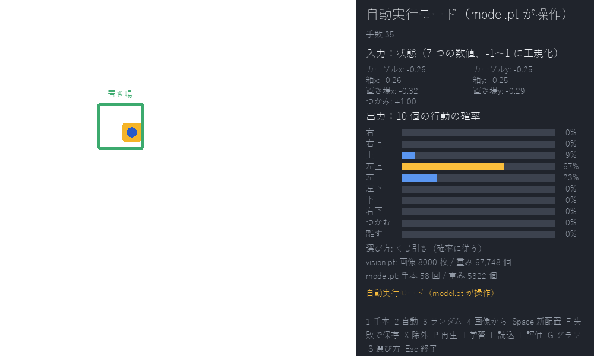
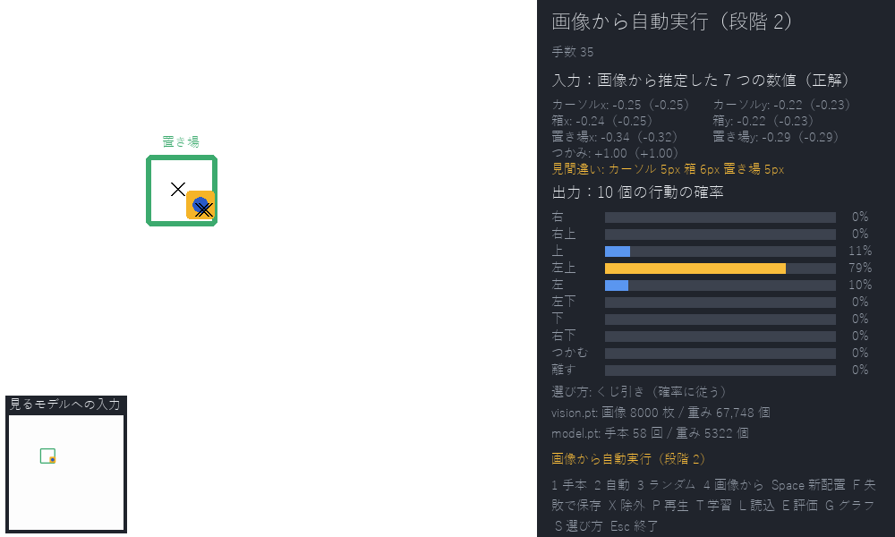
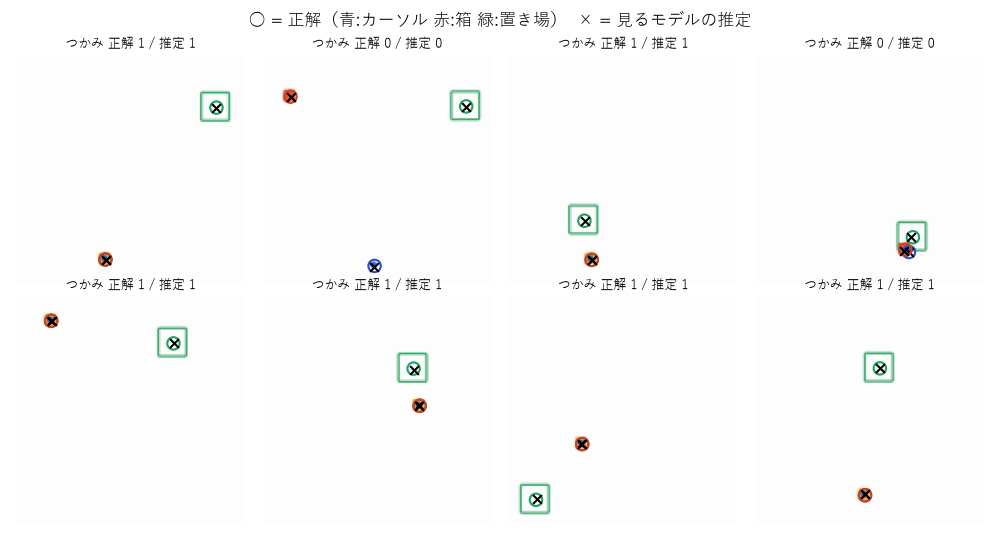
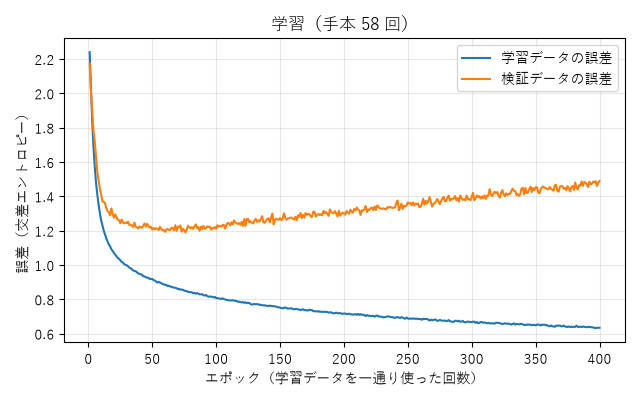
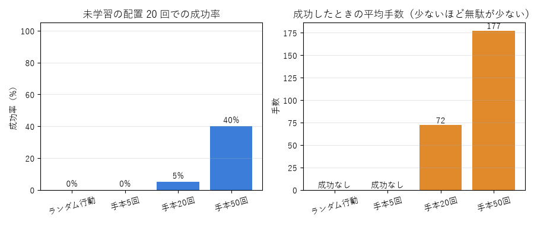
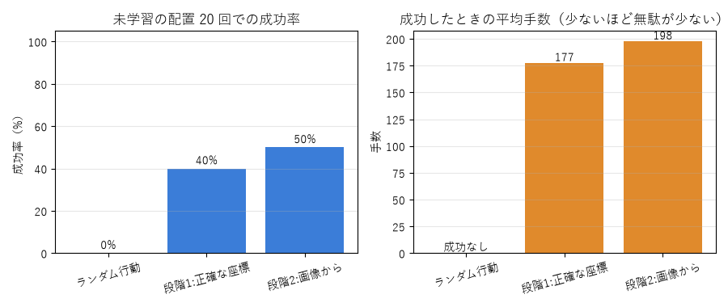

# 模倣学習 PoC（段階 1・段階 2）

画面の中で、人がマウスで箱を置き場へ運ぶ手本を記録し、その「状態 → 行動」を小さなニューラルネットに学習させて、未学習の配置で自動実行・評価する個人 PoC です。

- 段階 1：座標などの 7 つの数値から行動を学ぶ（動くモデル `model.pt`）
- 段階 2：画面の画像から 7 つの数値を推定する見るモデル（`vision.pt`）を加え、「画像 → 見るモデル → 動くモデル → 行動」で動かす（分割型）

- 説明は [docs/説明メモ.md](docs/説明メモ.md)（段階 1）と [docs/段階2メモ.md](docs/段階2メモ.md)、判断の記録は [docs/判断ログ.md](docs/判断ログ.md) にあります。
- 環境：Windows 11、Python 3.12、PyTorch（CPU 版）、pygame、matplotlib、numpy

## 画面と結果

動くモデルはすべて、自分で記録した手本（最大 58 回）で学習したものです。見るモデルは、自動で作った画像 8,000 枚で学習しています。

### 段階 1：座標から動く



左が作業領域です（青い丸がカーソル、黄色はつかまれている箱、緑の枠が置き場）。右側に、モデルへの入力（7 つの数値）と、出力（10 個の行動の確率）を表示しています。黄色の棒は、実際に選ばれた行動です。

### 段階 2：画像から動く（見るモデル → 動くモデル）



左下が、見るモデルに渡す 128×128 の画像です。作業領域の × は、見るモデルが「ここにある」と推定した位置です。右側には推定値と正解（括弧内）、見間違いの大きさを表示しています。



検証画像での位置のずれは平均 2〜3 ピクセル（600×600 の画面で）でした。○ が正解、× が見るモデルの推定です。

### 学習の誤差



学習データの誤差は下がり続けますが、検証データの誤差は 60 エポックあたりから上がっています。それでも、成功率は最後まで学習したほうが高くなりました。誤差と成功率は別物です（[docs/説明メモ.md](docs/説明メモ.md) の 5）。

### 成功率の比較（学習に使っていない配置 20 回）



手本の数を 5 回・20 回・50 回と変えたときの比較です。



正確な座標で動く段階 1 と、画像から動く段階 2 の比較です（手本 50 回のモデル）。差はくじ引きの出方による程度で、見るモデルはほぼ正確に見えています。成功率を決めているのは動くモデルのほうです（[docs/段階2メモ.md](docs/段階2メモ.md)）。

## セットアップ（済んでいれば不要）

```bash
py -3.12 -m venv .venv
.venv\Scripts\python -m pip install torch --index-url https://download.pytorch.org/whl/cpu
.venv\Scripts\python -m pip install -r requirements.txt
```

## 操作手順

### 1. 手本を記録する

```bash
.venv\Scripts\python app.py
```

- 起動すると手本モードになります。赤い箱にマウスを合わせ、左ボタンを押したまま緑の置き場まで運んで離してください。
- 青い丸が「記録されるカーソル」です。マウス（灰色の十字）を 1 コマ 1 歩ずつ、8 方向のどれかで追いかけます。速く動かすと青い丸が遅れて付いてくるので、ゆっくりめに動かすのがコツです。
- 置き場に入れて離すと、自動で「成功」として保存され、次の配置になります。
- うまくいかなかったときは `F` で「失敗」として保存（学習には使われません）、`Space` で保存せずに配置をやり直します。
- 直前の手本が雑だったときは `X` で除外の印を付けます（もう一度押すと外れます）。`P` で直前の手本を再生して確認できます。
- 比較のため、成功した手本を **50 回** を目安に記録してください（1 回 5〜10 秒ほど）。

### 2. 学習する

画面で `T` を押すと、学習に使える手本（成功・除外なし）すべてで学習し、`models/model.pt` に保存して誤差のグラフを表示します。グラフは `G` で再表示できます。

### 3. 自動実行と評価

- `2`：自動実行モード。モデルが毎コマ状態を見て行動を選びます。右側に入力の 7 つの数値と、10 個の行動の確率が表示されます。`+` `-` で速さを変えられます。
- `3`：ランダム行動モード（比較用）。
- `S`：行動の選び方を切り替えます。既定は「確率に従ってくじ引き」で、もう一方は「確率が最大の行動を必ず選ぶ」です。同じモデルでも成功率が変わります（[docs/説明メモ.md](docs/説明メモ.md) の 7）。
- `E`：学習に使っていない配置 20 回を早送りで実行し、成功率と平均手数を表示します。
- `L`：`model.pt` を読み込み直します。

### 4. 手本の数で比べる（コマンド）

```bash
.venv\Scripts\python train.py --compare 5 20 50
```

```bash
.venv\Scripts\python evaluate.py --compare
```

`evaluate.py --compare --greedy` にすると「確率が最大の行動を選ぶ」方式で比べます。`train.py` に `--early-stop` を付けると、検証誤差が最小だったエポックの重みで保存します（比較用。この課題では成功率が下がりました）。

先に記録した 5 回・20 回・50 回分で学習した `models/model_n5.pt` などを作り、ランダム行動と並べて同じ 20 配置で評価します。結果は `runs/compare.png` に、各学習の誤差グラフは `runs/<日時>_model_n*/loss.png` に保存されます。

### 5. 段階 2：画像から動かす

見るモデルを学習します（画像 8,000 枚を自動で作り、CPU で 7 分ほど）。

```bash
.venv\Scripts\python train_vision.py
```

- `app.py` で `4` を押すと「画像から自動実行」になります。左下に見るモデルへの入力画像（128×128）が、作業領域には推定した位置が × で表示されます。右側には推定値と正解、見間違いの大きさが出ます。
- 「画像から自動実行」の状態で `E` を押すと、画像から動かした場合の評価になります。
- 段階 1（正確な座標）と段階 2（画像から）を同じ 20 配置で比べるには、次を実行します。

```bash
.venv\Scripts\python evaluate.py --vision
```

- 人が画像に印を付ける体験（アノテーション）は、次で行えます。画像ごとにカーソル → 箱 → 置き場の中心をクリックし、箱が黄色（つかんでいる）なら `H`、`Enter` で保存します。`Esc` で、人の印と見るモデルのずれを正解と比べた集計が出ます。

```bash
.venv\Scripts\python annotate.py
```

## ファイル構成

| パス | 内容 |
| --- | --- |
| `app.py` | pygame の画面 |
| `train.py` / `evaluate.py` | コマンドでの学習・評価 |
| `poc/env.py` | 箱運びの環境（ルール・状態・行動） |
| `poc/demos.py` | 手本の保存・読み込み |
| `poc/policy.py` | モデル・学習・保存 |
| `poc/runner.py` | 自動実行（閉ループ）・評価 |
| `poc/render.py` | 画面の描画（段階 2 では見るモデルへの入力画像も作る） |
| `poc/vision.py` | 段階 2 の見るモデル・画像データ作成・学習 |
| `train_vision.py` | 見るモデルの学習 |
| `annotate.py` | 人が画像に印を付けるアノテーション画面 |
| `tools/make_synthetic_demos.py` | 動作確認専用の合成手本 |
| `data/demos/` | 記録した手本（1 回 1 ファイルの JSON） |
| `models/` | 学習したモデル |
| `runs/` | 誤差グラフ・評価グラフ |

`data/` `models/` `runs/` は git の管理対象外にしています。データ形式の見本として、合成の手本 5 回分だけを `samples/demos/` に入れています（[samples/README.md](samples/README.md)）。手本を残したい場合は `.gitignore` から `data/demos/` を外してください。

## 動作確認用の合成手本（任意）

人の手本の代わりに機械が作る手本で、仕組みだけを先に確かめられます。結果は人の手本と混ざらないよう別フォルダに出します。

```bash
.venv\Scripts\python tools\make_synthetic_demos.py --n 50
```

```bash
.venv\Scripts\python train.py --data-dir data/synthetic --compare 5 20 50 --model-dir models_synthetic
```

```bash
.venv\Scripts\python evaluate.py --compare --model-dir models_synthetic
```
